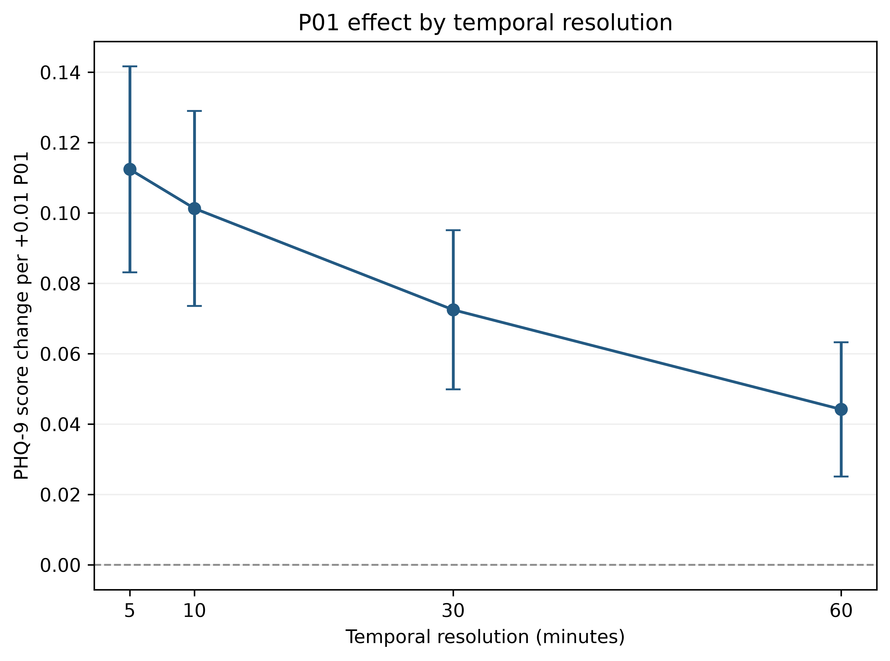

# Nocturnal Rest-to-Activity Transition Probability and Depressive Symptoms in NHANES 2013–2014: A Cross-Sectional Actigraphy Study

**Minjun Park**
Department of Medicine, Sapporo Medical University, Sapporo, Japan
Corresponding author: Minjun Park · a25m080@sapmed.ac.jp · ORCID: 0009-0002-5305-3491

## Abstract

**Background:** Actigraphy can characterize nocturnal movement patterns, but a single duration summary may not capture how activity changes over time. We examined the cross-sectional association between nocturnal rest-to-activity transition probability (P01) and depressive symptom burden in NHANES 2013–2014.

**Methods:** This secondary analysis used seven full NHANES protocol wear days (PAXDAYD 2–8). Participants required at least four adequate days, each with at least 600 valid minutes, including at least one adequate weekend day. PHQ-9 was scored from all nine DPQ010–DPQ090 items (range 0–27); the continuous score was primary. Minute-level MIMS activity (PAXMTSM) was time-reconstructed using the PAM start time and sample counter. The primary P01 used complete, clock-aligned 10-minute blocks in a fixed 22:00–06:00 window, a participant-specific median activity threshold, and only exactly adjacent valid nocturnal blocks. OLS models used HC3 standard errors: Model 1 adjusted for age, sex, and BMI (N=4,508); Model 2 additionally adjusted for poverty-income ratio, self-reported usual weekday/workday sleep duration, and an actigraphy-derived WASO proxy (N=4,048). Survey-weighted models and 5-, 10-, 30-, and 60-minute P01 analyses were sensitivity analyses. Exploratory PHQ-9 ≥10 discrimination used stratified five-fold cross-validation and out-of-fold predictions.

**Results:** P01 was positively associated with PHQ-9 in Model 1 (β=10.12663, HC3 SE=1.41342, 95% CI 7.35564–12.89762, p=9.07×10⁻¹³) and Model 2 (β=5.72278, HC3 SE=1.65435, 95% CI 2.47934–8.96622, p=5.47×10⁻⁴). A +0.01 probability-unit difference corresponded to 0.10127 and 0.05723 PHQ-9 points, respectively. Survey-weighted Model 2 was directionally consistent (β=5.86690, 95% CI 1.54967–10.18413, p=0.0200). Associations were positive at all tested temporal resolutions, with smaller coefficients at coarser resolutions. Out-of-fold AUCs were 0.613 for demographics, 0.591 for P01 alone, and 0.632 for demographics plus P01; the paired increment was 0.018 (95% CI 0.008–0.030).

**Conclusions:** In this cross-sectional NHANES analysis, corrected nocturnal P01 was associated with questionnaire-based depressive symptom burden. Incremental cross-validated discrimination was modest. P01 is a complementary actigraphy-derived behavioral measure, not a diagnostic or validated clinical tool; external validation is absent.

**Keywords:** actigraphy; depressive symptoms; PHQ-9; NHANES; physical activity monitoring; transition probability

## 1. Introduction

Depressive symptoms co-occur with differences in sleep and circadian rest-activity patterns [6]. Wrist-worn activity monitoring offers a way to describe movement in everyday settings, but actigraphy records movement-derived states rather than physiological sleep stages. A participant's nocturnal movement may be summarized by duration, timing, or the sequence of changes between relatively lower- and higher-activity periods.

Digital-phenotyping research has also highlighted the limitations of relying only on time-averaged features and the potential value of methods that retain temporal dynamics [7]. We examined a compact transition measure, nocturnal rest-to-activity transition probability (P01), in the publicly available NHANES 2013–2014 sample. The question was whether this complementary behavioral measure was cross-sectionally associated with continuous PHQ-9 symptom burden after demographic and sleep-related adjustment. We also estimated its incremental out-of-fold discrimination for PHQ-9 scores of 10 or higher as an exploratory secondary analysis. These analyses do not establish temporal direction, causality, diagnostic performance, or suitability for clinical decision-making.

## 2. Methods

### 2.1 Study design and data source

This cross-sectional secondary analysis combined NHANES 2013–2014 physical activity monitor (PAM) minute data and demographic, examination, sleep-questionnaire, and depression-questionnaire data. PAM minute activity is reported as Monitor-Independent Movement Summary (MIMS; PAXMTSM), an open-source device-independent acceleration summary metric [8]. NHANES data are publicly available and de-identified. The parent NHANES protocol was reviewed by the National Center for Health Statistics Research Ethics Review Board, and participants provided informed consent [2,3].

### 2.2 Analytic cohort

The protocol wear window comprised the seven full wear days, PAXDAYD 2–8. An adequate day required PAXQFD=0 and at least 600 valid wear minutes (PAXVMD); participants were retained with at least four adequate days, including at least one adequate weekend day. The corrected eligible cohort comprised 4,882 participants. Model-specific complete-case samples were smaller because covariate availability differed; model Ns are reported separately.

### 2.3 Depressive symptoms

The PHQ-9 was scored as the sum of DPQ010 through DPQ090. Responses coded 7 or 9 and other invalid responses were treated as missing; all nine items were required for a score, which ranged from 0 to 27. DPQ100 was not included. Continuous PHQ-9 was the primary outcome. PHQ-9 ≥10 was the secondary binary outcome for exploratory discrimination, not a clinical diagnosis [1].

### 2.4 P01 construction

We used minute-level MIMS activity (PAXMTSM) from NHANES PAM files. Local time was reconstructed from participant-specific PAXFTIME and the elapsed 80-Hz sample coordinate PAXSSNMP, rather than row order. A minute was eligible only when PAXQFM equaled 0, PAXMTSM was finite and nonnegative, PAXTSM equaled 60 seconds, and its reconstructed time was minute-aligned. For the primary measure, eligible minutes were summed into clock-aligned, non-overlapping 10-minute blocks. A block was retained only when all ten distinct, consecutive minute records were present and valid; incomplete blocks were excluded without imputation.

The participant-specific activity threshold was the median summed activity across that participant's complete blocks at the selected resolution. Each complete block was classified as state 0 (activity at or below the threshold) or state 1 (above the threshold). The nocturnal window was fixed at 22:00–06:00: the evening segment (22:00–24:00) and following morning (00:00–06:00) were assigned to the same night. Blocks were ordered by reconstructed time within night. An edge was eligible only when the next block began exactly one resolution interval later. Thus, no transition crossed daylight, a missing or invalid block, a temporal gap, or a night boundary.

P01 was the number of eligible state 0→1 transitions divided by the number of eligible outgoing edges whose current state was 0, pooled across eligible nights. A zero denominator yielded a missing P01. The primary resolution was 10 minutes; 5-, 30-, and 60-minute resolutions were evaluated separately as sensitivity analyses. Rest and active denote relative movement categories, not polysomnographic sleep and wake stages.

### 2.5 Covariates and sleep measures

Model 1 included age, sex, and BMI. Model 2 additionally included poverty-income ratio (PIR), self-reported usual weekday/workday sleep duration from SLD010H, and an actigraphy-derived WASO proxy based on predicted wear/sleep labels (PAXPREDM). SLD010H is self-reported duration, not actigraphy-derived sleep duration. The PAXPREDM measure is a proxy and was not independently validated as WASO. Continuous covariates other than P01 were standardized within each model's complete-case sample; sex was categorical. P01 remained on its raw 0–1 probability scale.

### 2.6 Statistical analysis

The primary analysis used ordinary least squares (OLS) with HC3 heteroskedasticity-robust standard errors. Model 1 was PHQ-9 ~ P01 + age + sex + BMI. Model 2 added PIR, self-reported weekday/workday sleep duration, and the actigraphy-derived WASO proxy. Coefficients, HC3 standard errors, 95% confidence intervals, and two-sided p-values are reported. Because P01 is scaled from 0 to 1, its coefficient represents a one-unit increase; for interpretability, effects for a +0.01 probability-unit difference are also reported. These unweighted HC3 estimates are not design-based nationally representative estimates.

For exploratory discrimination of PHQ-9 ≥10, we compared a demographic baseline (age, sex, BMI), P01 alone, and demographics plus P01 using stratified five-fold cross-validation. AUCs were calculated from out-of-fold predictions; paired bootstrap resampling of those predictions estimated confidence intervals for the combined-versus-baseline AUC difference. Discrimination results are exploratory and do not constitute model validation or evidence for clinical decisions.

## 3. Results

### 3.1 Corrected analytic cohort

The corrected wear-qualified cohort included 4,882 participants, and all had a corrected 10-minute P01 value. The primary Model 1 complete-case sample was 4,508; the extended Model 2 sample was 4,048. Table 1 presents the corrected cohort descriptors. The PHQ-9 group counts shown there are among participants with a complete score.

**Table 1. Corrected analytic cohort characteristics.** Source: `outputs/tables/table1_corrected.csv`. SLD010H is self-reported usual weekday sleep duration. The participant-level WASO proxy values were not retained in the accepted analysis outputs and are reported as unavailable in the source table.
| Characteristic | Overall | PHQ-9 <10 | PHQ-9 ≥10 |
|---|---:|---:|---:|
| Participants, N | 4,882 | 4,112 | 434 |
| Female, n (%) | 2,641 (54.1%) | 2,151 (52.3%) | 293 (67.5%) |
| Age, years, mean (SD) | 48.0 (18.3) | 47.6 (18.4) | 50.4 (17.2) |
| BMI, kg/m², mean (SD) | 29.1 (7.2) | 28.9 (6.9) | 31.6 (9.5) |
| Poverty-income ratio, mean (SD) | 2.45 (1.64) | 2.56 (1.65) | 1.74 (1.34) |
| Self-reported usual weekday sleep, hours, mean (SD) | 6.9 (1.4) | 6.9 (1.4) | 6.5 (1.8) |
| Corrected P01_10m, mean (SD) | 0.073 (0.051) | 0.072 (0.050) | 0.085 (0.050) |
| PHQ-9 score, mean (SD) | 3.3 (4.4) | 2.2 (2.5) | 14.2 (3.8) |

### 3.2 Primary association of P01 with PHQ-9

P01 was positively associated with continuous PHQ-9 in both HC3 OLS models. Model 1 (N=4,508) estimated β=10.12663 (HC3 SE=1.41342, 95% CI 7.35564–12.89762, p=9.07×10⁻¹³), corresponding to 0.10127 PHQ-9 points per +0.01 P01. Model 2 (N=4,048) estimated β=5.72278 (HC3 SE=1.65435, 95% CI 2.47934–8.96622, p=5.47×10⁻⁴), or 0.05723 points per +0.01 P01. The extended-model estimate was attenuated relative to the historical analysis while remaining positive. Table 2 contains the corrected primary estimates.

**Table 2. Corrected primary HC3 OLS models for continuous PHQ-9.** Source: `outputs/tables/table2_primary_corrected.csv`. Covariates other than P01 were standardized within each model's complete-case sample.
| Model | N | P01 β | HC3 SE | 95% CI | p | Effect per +0.01 P01 |
|---|---:|---:|---:|---:|---:|---:|
| Model 1 | 4,508 | 10.127 | 1.413 | 7.356–12.898 | 9.07×10⁻¹³ | 0.101 |
| Model 2 | 4,048 | 5.723 | 1.654 | 2.479–8.966 | 5.47×10⁻⁴ | 0.057 |

### 3.3 Survey-weighted sensitivity

The survey-weighted sensitivity analysis used WTMEC2YR with SDMVSTRA and SDMVPSU. Model 2 remained positive (β=5.86690, 95% CI 1.54967–10.18413, p=0.0200; N=4,048), consistent in direction with the primary HC3 result. Model 1 was also positive (β=10.19673, 95% CI 6.12162–14.27184, p=0.000240; N=4,508). Estimates are reported in Supplementary Table S1.

### 3.4 Temporal-resolution sensitivity

Associations remained positive at each tested resolution: 5 minutes β=11.23806 (95% CI 8.31263–14.16348), 10 minutes β=10.12663 (7.35564–12.89762), 30 minutes β=7.24560 (4.98656–9.50464), and 60 minutes β=4.41545 (2.50630–6.32461); each model had N=4,508. Coefficient magnitude decreased at coarser resolutions. These are distinct resolutions, not interchangeable measurements. Supplementary Table S2 gives the estimates; Figure 2 plots effects per +0.01 P01.

### 3.5 Exploratory cross-validated discrimination

Using stratified five-fold cross-validation and out-of-fold predictions, AUC was 0.613 for the demographic baseline, 0.591 for P01 alone, and 0.632 for demographics plus P01. The paired combined-versus-baseline increment was 0.018 (95% CI 0.008–0.030). This statistically detectable increase was modest; P01 alone did not exceed the demographic baseline. Figure 1 shows the cross-validated ROC results.

## 4. Discussion

In this cross-sectional NHANES analysis, nocturnal P01 was positively associated with PHQ-9 symptom burden in the corrected primary models. The association was robust to HC3 inference and remained directionally consistent in the survey-weighted sensitivity analysis and across all four tested temporal resolutions. The more extensively adjusted estimate was attenuated relative to the historical analysis but remained positive. P01 therefore represents a potentially complementary actigraphy-derived behavioral measure; these data do not establish that it is superior to any sleep measure or identify a mechanism.

The corrected P01 definition explicitly requires temporal adjacency. Activity states are assigned to complete clock-aligned blocks, the evening and following morning form a single fixed nocturnal window, and an observed transition is counted only between blocks separated by exactly one interval. This avoids treating sequential records as adjacent when daylight, missingness, invalid data, or a temporal gap intervenes. The participant-specific median is a simple threshold choice; other defensible thresholds may yield different state sequences and should be evaluated in replication.

A recent survey-weighted NHANES 2011–2014 analysis also reported an association between accelerometer-derived sleep irregularity and depression, although that work addressed between-day regularity rather than within-night state switching [9]. The survey-weighted sensitivity estimate in the present study supports the direction of the primary association after incorporating the supplied examination weight, strata, and primary sampling units. It is a sensitivity analysis, not proof that all analytic selection or nonresponse issues are resolved. The cross-validated ROC comparison indicates a statistically detectable but modest incremental discrimination: the combined model AUC was 0.632 versus 0.613 for demographics. This exploratory contrast does not support individual-level screening or diagnostic application, and no external validation was performed.

Several limitations constrain interpretation. The cross-sectional design cannot establish temporal order or causal effects. PHQ-9 is a questionnaire measure of symptoms, not a clinician-established diagnosis. Actigraphy-derived activity states are not polysomnographic sleep stages, and the 22:00–06:00 window may not represent each participant's sleep interval or chronotype. The relative threshold depends on each participant's observed activity distribution. Residual confounding may remain, including medical and psychiatric comorbidity, medication use, substance use, work schedules, and other determinants of sleep and mood. The PAXPREDM-derived WASO proxy should not be interpreted as validated WASO, and SLD010H is self-reported usual weekday/workday sleep duration. Finally, external validation in an independent population is absent.

## 5. Conclusion

Corrected nocturnal rest-to-activity transition probability was positively associated with questionnaire-based depressive symptom burden in NHANES 2013–2014. The association persisted in survey-weighted and temporal-resolution sensitivity analyses, while incremental out-of-fold discrimination was modest. P01 is a complementary behavioral measure for research; the cross-sectional findings do not establish causality, diagnosis, screening utility, or validated prediction.

## Declarations

**Ethics approval and consent to participate:** This secondary analysis used publicly available, de-identified NHANES data. The parent NHANES protocol was approved by the National Center for Health Statistics Research Ethics Review Board, and participants provided informed consent. No additional participant contact occurred.

**Consent for publication:** Not applicable.

**Funding:** No specific grant was received from any funding agency in the public, commercial, or not-for-profit sectors.

**Competing interests:** The author declares no competing interests.

**Data and code availability:** NHANES 2013–2014 data are publicly available from the U.S. Centers for Disease Control and Prevention. Analysis code and accepted analysis outputs are available at https://github.com/0ArchLinux0/Nocturnal-Rest-Activity-Transition-Instability_NHANES-2013-2014.

**Acknowledgements:** The author thanks Professor Ayako Sumi at Sapporo Medical University for insights and support, and acknowledges NCHS/CDC for providing NHANES data. The conclusions are those of the author and do not represent the official position of NCHS or CDC.

**Use of artificial intelligence:** Artificial intelligence tools were used for language editing, structural refinement, and consistency checking. The author retained responsibility for the research question, analysis, interpretation, and final manuscript content.

## References

1. Kroenke K, Spitzer RL, Williams JB. The PHQ-9: validity of a brief depression severity measure. *Journal of General Internal Medicine*. 2001;16(9):606–613. doi:10.1046/j.1525-1497.2001.016009606.x.
2. Centers for Disease Control and Prevention, National Center for Health Statistics. NHANES 2013–2014: Physical Activity Monitor - Minute (PAXMIN_H), Data Documentation, Codebook, and Frequencies. https://wwwn.cdc.gov/Nchs/Data/Nhanes/Public/2013/DataFiles/PAXMIN_H.htm (accessed 16 October 2026).
3. Centers for Disease Control and Prevention, National Center for Health Statistics. *NHANES Analytic Guidelines, 2011–2014 and 2015–2016*. https://wwwn.cdc.gov/nchs/data/nhanes/analyticguidelines/11-16-analytic-guidelines.pdf (accessed 16 October 2026).
4. Centers for Disease Control and Prevention, National Center for Health Statistics. NHANES 2013–2014: Mental Health - Depression Screener (DPQ_H), Data Documentation, Codebook, and Frequencies. https://wwwn.cdc.gov/Nchs/Data/Nhanes/Public/2013/DataFiles/DPQ_H.htm (accessed 16 October 2026).
5. Centers for Disease Control and Prevention, National Center for Health Statistics. NHANES 2013–2014: Sleep Disorders (SLQ_H), Data Documentation, Codebook, and Frequencies. https://wwwn.cdc.gov/Nchs/Data/Nhanes/Public/2013/DataFiles/SLQ_H.htm (accessed 16 October 2026).
6. Hori H, Koga N, Hidese S, Nagashima A, Kim Y, Higuchi T, Kunugi H. 24-h activity rhythm and sleep in depressed outpatients. *Journal of Psychiatric Research*. 2016;77:27–34. doi:10.1016/j.jpsychires.2016.02.022.
7. Leaning IE, Ikani N, Savage HS, Leow A, Beckmann C, Ruhé HG, Marquand AF. From smartphone data to clinically relevant predictions: a systematic review of digital phenotyping methods in depression. *Neuroscience & Biobehavioral Reviews*. 2024;158:105541. doi:10.1016/j.neubiorev.2024.105541.
8. John D, Tang Q, Albinali F, Intille S. An open-source monitor-independent movement summary for accelerometer data processing. *Journal for the Measurement of Physical Behaviour*. 2019;2(4):268–281. doi:10.1123/jmpb.2018-0068.
9. Zhao B, Huang X, Xing Y, Luo H, Ye Z, Xu W, Shao J. Sleep irregularity and depression among U.S. adults: an accelerometer-based cross-sectional study in NHANES. *Sleep Health*. 2026;12(4):612–618. doi:10.1016/j.sleh.2026.04.007.

## Supplementary material

**Supplementary Table S1. Survey-weighted P01 sensitivity models using WTMEC2YR, SDMVSTRA, and SDMVPSU.** Source: `outputs/tables/tableS1_survey_weighted.csv`.
| Model | N | P01 β | SE | 95% CI | p |
|---|---:|---:|---:|---:|---:|
| Model 1 | 4,508 | 10.197 | 1.912 | 6.122–14.272 | 2.40×10⁻⁴ |
| Model 2 | 4,048 | 5.867 | 2.025 | 1.550–10.184 | 0.0200 |

**Supplementary Table S2. Corrected P01 estimates by 5-, 10-, 30-, and 60-minute temporal resolution.** Source: `outputs/tables/tableS2_resolution_sensitivity.csv`.
|---:|---:|---:|---:|---:|---:|
| 5 | 4,508 | 11.238 | 1.492 | 8.313–14.163 | 6.04×10⁻¹⁴ |
| 10 | 4,508 | 10.127 | 1.413 | 7.356–12.898 | 9.07×10⁻¹³ |
| 30 | 4,508 | 7.246 | 1.152 | 4.987–9.505 | 3.52×10⁻¹⁰ |
| 60 | 4,508 | 4.415 | 0.974 | 2.506–6.325 | 5.93×10⁻⁶ |
