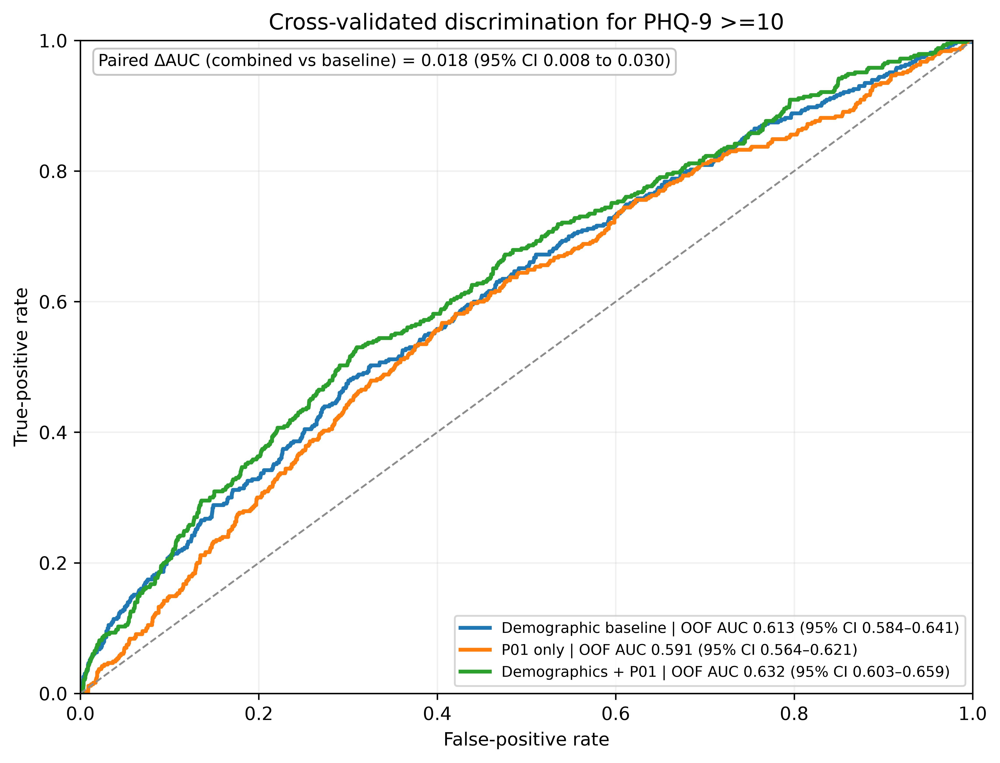

# Nocturnal Rest-to-Activity Transition Probability and Depressive Symptoms in NHANES 2013–2014: A Cross-Sectional Actigraphy Study

**Minjun Park**

Department of Medicine, Sapporo Medical University, Sapporo, Japan

Corresponding author: Minjun Park · a25m080@sapmed.ac.jp · ORCID: 0009-0002-5305-3491

## Abstract

Using NHANES 2013–2014, we tested whether nocturnal rest-to-activity transition probability (P01), derived from wrist actigraphy, was associated with depressive symptom burden. Participants contributed seven protocol wear days, with at least four adequate days (≥600 valid minutes/day, including one weekend day). P01 was calculated from complete, clock-aligned 10-minute blocks in a fixed 22:00–06:00 window; transitions required exact temporal adjacency. PHQ-9 was scored from all nine DPQ010–DPQ090 items. HC3 ordinary least-squares models adjusted for age, sex, and BMI (Model 1; N=4,508) and additionally for poverty-income ratio, self-reported weekday/workday sleep duration, and an actigraphy-derived WASO proxy (Model 2; N=4,048). P01 was positively associated with PHQ-9 in Model 1 (β=10.12663, 95% CI 7.35564–12.89762) and Model 2 (β=5.72278, 95% CI 2.47934–8.96622). Survey-weighted Model 2 was directionally consistent (β=5.86690, p=0.0200). In exploratory stratified five-fold cross-validation, adding P01 to demographic predictors increased out-of-fold AUC from 0.613 to 0.632 (Δ=0.018, 95% CI 0.008–0.030). The cross-sectional association does not establish causality; discrimination was modest and external validation is absent.

**Keywords:** Actigraphy; depressive symptoms; PHQ-9; NHANES; physical activity monitoring; transition probability

## 1. Introduction

Sleep disturbance is clinically relevant to depression both as a concurrent symptom domain and as a correlate of subsequent illness. A meta-analysis of longitudinal epidemiological studies found that insomnia among initially non-depressed individuals was associated with later depression, although intervening variables were not consistently addressed (Baglioni et al., 2011). Prospective evidence has also linked both short and long sleep duration with subsequent depression (Zhai et al., 2015). These findings motivate closer description of everyday sleep and rest-activity behavior without implying that any single behavioral measure identifies a depressive disorder. Wrist actigraphy provides unobtrusive recordings over multiple days in natural environments. In a systematic review, depressed patients showed lower daytime activity than controls, and activity changed over treatment, but studies varied in their methods and community-based evidence was limited (Burton et al., 2013). Importantly, movement recordings provide indirect behavioral information rather than the physiological signals used to determine sleep stages (Ancoli-Israel et al., 2003).

The literature encompasses several related but distinct dimensions: sleep duration and continuity, average activity level, the amplitude and timing of 24-hour rest-activity rhythms, and regularity across days. Hori et al. (2016) examined sleep duration, wake after sleep onset, sleep fragmentation, and cosinor-derived rhythm measures in depressed outpatients, reporting lower rhythm-adjusted mean activity and dampened amplitude alongside sleep disturbance. At a larger population scale, lower accelerometer-derived relative amplitude was associated with lifetime major depressive disorder in UK Biobank, including after adjustment for overall mean acceleration (Lyall et al., 2018). Sleep regularity addresses another aspect of organization. The sleep regularity index compares sleep/wake states at time points 24 hours apart, rather than measuring only accumulated sleep duration (Phillips et al., 2017). Together, these approaches show why duration, activity magnitude, daily rhythmicity, and between-day regularity should not be treated as interchangeable descriptions of behavior.

Within-night sequential switching offers a further, explicitly local description. Cumulative duration and mean activity do not directly specify the order in which lower- and higher-activity periods occur: comparable totals can arise from relatively consolidated periods or from repeated alternation. This distinction does not imply that existing actigraphic methods ignore temporal organization. Probabilistic state-transition analyses have already quantified rest-activity fragmentation in community-dwelling older adults (Lim et al., 2011), and sleep fragmentation was included in the outpatient depression study described above (Hori et al., 2016). Rather, it motivates examining a transparent transition summary alongside conventional sleep-related measures. A review of smartphone-based digital phenotyping in depression identified frequent reliance on time-averaged features and suggested that more direct attention to temporal dynamics may be useful (Leaning et al., 2024). Recent population-based work has also evaluated multiple wearable-derived physical-behavior features in classifying depressive symptoms (Sameh et al., 2026). This broader digital-phenotyping context motivates feature evaluation without establishing the clinical usefulness of a particular wearable-derived measure.

We therefore examined nocturnal rest-to-activity transition probability (P01) in a large sample from publicly available NHANES 2013–2014 data. P01 describes the proportion of eligible adjacent block pairs beginning in a relatively lower-activity state that end in a relatively higher-activity state, using participant-specific median thresholds and complete, clock-aligned 10-minute blocks within a fixed 22:00–06:00 window. Only exactly contiguous blocks within the same night contribute; missing or invalid blocks, temporal gaps, and night boundaries cannot be bridged. These are movement-defined states, not physiological sleep and wake classifications. Our primary question was whether P01 was cross-sectionally associated with continuous PHQ-9 symptom burden after demographic and sleep-related adjustment. Primary inference used ordinary least squares with HC3 heteroskedasticity-robust standard errors; survey-design and alternative temporal-resolution analyses assessed sensitivity. Because the primary models were unweighted, they were not interpreted as design-based nationally representative estimates. Incremental out-of-fold discrimination of PHQ-9 scores of 10 or higher was a secondary, exploratory question. The study evaluates a simple complementary behavioral descriptor, not causality, superiority to established sleep measures, or suitability for diagnosis or screening.

## 2. Methods

### 2.1 Study design and data source

This cross-sectional secondary analysis combined NHANES 2013–2014 physical activity monitor (PAM) minute data and demographic, examination, sleep-questionnaire, and depression-questionnaire data. PAM minute activity is reported as Monitor-Independent Movement Summary (MIMS; PAXMTSM), an open-source device-independent acceleration summary metric (John et al., 2019). NHANES data are publicly available and de-identified (Centers for Disease Control and Prevention, National Center for Health Statistics [CDC/NCHS], n.d.-a, n.d.-b, n.d.-c). NHANES 2013–2014 was conducted as a continuation of NCHS Research Ethics Review Board Protocol #2011-17; participants provided informed consent under the parent NHANES protocol.

### 2.2 Analytic cohort

The protocol wear window comprised the seven full wear days, PAXDAYD 2–8. An adequate day required PAXQFD=0 and at least 600 valid wear minutes (PAXVMD); participants were retained with at least four adequate days, including at least one adequate weekend day. The eligible cohort comprised 4,882 participants. Model-specific complete-case samples were smaller because outcome and covariate availability differed; model Ns are reported separately.

### 2.3 Depressive symptoms

The PHQ-9 was scored as the sum of DPQ010 through DPQ090. Responses coded 7 or 9 and other invalid responses were treated as missing; all nine items were required for a score, which ranged from 0 to 27. DPQ100 was not included. Continuous PHQ-9 was the primary outcome. PHQ-9 ≥10 was the secondary binary outcome for exploratory discrimination, not a clinical diagnosis (Kroenke et al., 2001; CDC/NCHS, n.d.-a).

### 2.4 P01 construction

We used minute-level MIMS activity (PAXMTSM) from NHANES PAM files. Local time was reconstructed from participant-specific PAXFTIME and the elapsed 80-Hz sample coordinate PAXSSNMP, rather than row order. A minute was eligible only when PAXQFM equaled 0, PAXMTSM was finite and nonnegative, PAXTSM equaled 60 seconds, and its reconstructed time was minute-aligned. For the primary measure, eligible minutes were summed into clock-aligned, non-overlapping 10-minute blocks. A block was retained only when all ten distinct, consecutive minute records were present and valid; incomplete blocks were excluded without imputation.

The participant-specific activity threshold was the median summed activity across that participant's complete blocks at the selected resolution. Each complete block was classified as state 0 (activity at or below the threshold) or state 1 (above the threshold). The nocturnal window was fixed at 22:00–06:00: the evening segment (22:00–24:00) and following morning (00:00–06:00) were assigned to the same night. Blocks were ordered by reconstructed time within night. An edge was eligible only when the next block began exactly one resolution interval later. Thus, no transition crossed daylight, a missing or invalid block, a temporal gap, or a night boundary.

P01 was the number of eligible state 0→1 transitions divided by the number of eligible outgoing edges whose current state was 0, pooled across eligible nights. A zero denominator yielded a missing P01. The primary resolution was 10 minutes; 5-, 30-, and 60-minute resolutions were evaluated separately as sensitivity analyses. Rest and active denote relative movement categories, not polysomnographic sleep and wake stages.

### 2.5 Covariates and sleep measures

Model 1 included age, sex, and BMI. Model 2 additionally included poverty-income ratio (PIR), self-reported usual weekday/workday sleep duration from SLD010H, and an actigraphy-derived WASO proxy based on predicted wear/sleep labels (PAXPREDM). SLD010H is self-reported duration, not actigraphy-derived sleep duration (CDC/NCHS, n.d.-c). The PAXPREDM measure is a proxy and was not independently validated as WASO. Continuous covariates other than P01 were standardized within each model's complete-case sample; sex was categorical. P01 remained on its raw 0–1 probability scale.

### 2.6 Statistical analysis

The primary analysis used ordinary least squares (OLS) with HC3 heteroskedasticity-robust standard errors. Model 1 was PHQ-9 ~ P01 + age + sex + BMI. Model 2 added PIR, self-reported weekday/workday sleep duration, and the actigraphy-derived WASO proxy. Coefficients, HC3 standard errors, 95% confidence intervals, and two-sided p-values are reported. Because P01 is scaled from 0 to 1, its coefficient represents a one-unit increase; for interpretability, effects for a +0.01 probability-unit difference are also reported. These unweighted HC3 estimates are not design-based nationally representative estimates.

For exploratory discrimination of PHQ-9 ≥10, we compared a demographic baseline (age, sex, BMI), P01 alone, and demographics plus P01 using stratified five-fold cross-validation. AUCs were calculated from out-of-fold predictions; paired bootstrap resampling of those predictions estimated confidence intervals for the combined-versus-baseline AUC difference. Discrimination results are exploratory and do not constitute model validation or evidence for clinical decisions.

## 3. Results

### 3.1 Analytic cohort

The wear-qualified cohort included 4,882 participants, all with a 10-minute P01 value. The primary Model 1 complete-case sample was 4,508; the extended Model 2 sample was 4,048. Table 1 presents cohort characteristics. PHQ-9 groups include only participants with complete scores; the overall column also includes participants without a complete score.

**Table 1. Analytic cohort characteristics.** Continuous variables are mean (SD), with available-case n shown; female percentages use the column participant count. PHQ-9 groups contain 4,546 participants with complete scores; 336 participants without a complete score appear only in the overall column. Available-case denominators vary by characteristic and are not model complete-case Ns. SLD010H measures self-reported usual weekday/workday sleep duration.
| Characteristic | Overall | PHQ-9 <10 | PHQ-9 ≥10 |
|---|---:|---:|---:|
| Participants, N | 4,882 | 4,112 | 434 |
| Female, n (%) | 2,641 (54.1%) | 2,151 (52.3%) | 293 (67.5%) |
| Age, years | 48.0 (18.3); n=4,882 | 47.6 (18.4); n=4,112 | 50.4 (17.2); n=434 |
| BMI, kg/m² | 29.1 (7.2); n=4,836 | 28.9 (6.9); n=4,078 | 31.6 (9.5); n=430 |
| Poverty-income ratio | 2.45 (1.64); n=4,527 | 2.56 (1.65); n=3,835 | 1.74 (1.34); n=398 |
| Self-reported usual weekday sleep, hours | 6.9 (1.4); n=4,877 | 6.9 (1.4); n=4,108 | 6.5 (1.8); n=433 |
| P01, 10-minute resolution | 0.073 (0.051); n=4,882 | 0.072 (0.050); n=4,112 | 0.085 (0.050); n=434 |
| PHQ-9 score | 3.3 (4.4); n=4,546 | 2.2 (2.5); n=4,112 | 14.2 (3.8); n=434 |

### 3.2 Primary association of P01 with PHQ-9

P01 was positively associated with continuous PHQ-9 in both HC3 OLS models. Model 1 (N=4,508) estimated β=10.12663 (HC3 SE=1.41342, 95% CI 7.35564–12.89762, p=9.07×10⁻¹³), corresponding to 0.10127 PHQ-9 points per +0.01 P01. Model 2 (N=4,048) estimated β=5.72278 (HC3 SE=1.65435, 95% CI 2.47934–8.96622, p=5.47×10⁻⁴), or 0.05723 points per +0.01 P01. Table 2 presents the primary estimates.

**Table 2. Primary HC3 OLS models for continuous PHQ-9.** Covariates other than P01 were standardized within each model's complete-case sample.
| Model | N | P01 β | HC3 SE | 95% CI | p | Effect per +0.01 P01 |
|---|---:|---:|---:|---:|---:|---:|
| Model 1 | 4,508 | 10.127 | 1.413 | 7.356–12.898 | 9.07×10⁻¹³ | 0.101 |
| Model 2 | 4,048 | 5.723 | 1.654 | 2.479–8.966 | 5.47×10⁻⁴ | 0.057 |

### 3.3 Survey-weighted sensitivity

The survey-weighted sensitivity analysis used WTMEC2YR with SDMVSTRA and SDMVPSU, following NCHS analytic guidance (CDC/NCHS, 2018). Model 2 remained positive (β=5.86690, 95% CI 1.54967–10.18413, p=0.0200; N=4,048), consistent in direction with the primary HC3 result. Model 1 was also positive (β=10.19673, 95% CI 6.12162–14.27184, p=0.000240; N=4,508). Estimates are reported in Supplementary Table S1.

### 3.4 Exploratory cross-validated discrimination

Using stratified five-fold cross-validation and out-of-fold predictions, AUC was 0.613 for the demographic baseline, 0.591 for P01 alone, and 0.632 for demographics plus P01. The paired combined-versus-baseline increment was 0.018 (95% CI 0.008–0.030). This statistically detectable increase was modest; P01 alone did not exceed the demographic baseline. Figure 1 shows the cross-validated ROC results.

### 3.5 Temporal-resolution sensitivity

Associations remained positive at each tested resolution: 5 minutes β=11.23806 (95% CI 8.31263–14.16348), 10 minutes β=10.12663 (7.35564–12.89762), 30 minutes β=7.24560 (4.98656–9.50464), and 60 minutes β=4.41545 (2.50630–6.32461); each model had N=4,508. Coefficient magnitude decreased at coarser resolutions. These are distinct resolutions, not interchangeable measurements. Supplementary Table S2 gives the estimates; Figure 2 plots effects per +0.01 P01.

## 4. Discussion

### 4.1 Principal finding and magnitude

In this cross-sectional NHANES 2013–2014 analysis, higher nocturnal rest-to-activity transition probability was associated with greater depressive symptom burden. In Model 2, which included demographic, socioeconomic, and sleep-related covariates, the P01 coefficient was 5.72278 (95% CI 2.47934–8.96622; N=4,048). Because P01 is expressed on a 0–1 scale, the corresponding estimate was 0.05723 PHQ-9 points per +0.01 probability-unit difference. This scaling is essential: statistical support for an association does not imply a large symptom difference or clinical importance for an individual. The smaller estimate after extended adjustment is compatible with overlap among measured correlates, but Model 1 and Model 2 used different complete-case samples. Their contrast therefore should not be interpreted as a mediation analysis. The result supports examining nocturnal movement organization as a complementary behavioral correlate of depressive symptoms, rather than treating P01 as a diagnostic marker. Adjustment for sleep duration and the WASO proxy does not establish that P01 captures a distinct biological process, nor does the observed association identify whether movement differences precede, follow, or share determinants with depressive symptoms.

### 4.2 Relation to existing literature

The findings fit within actigraphic evidence linking depression with altered rest-activity patterns, including reduced activity and sleep fragmentation (Hori et al., 2016). Probabilistic transition analysis also has established precedents for quantifying rest-activity fragmentation (Lim et al., 2011); the contribution here is the explicit application of a defined nocturnal P01 measure to questionnaire-based symptom burden. Its denominator conditions on eligible outgoing edges from the lower-activity state, so it does not simply count movements or measure the proportion of the night spent active. P01 describes the ordering of relatively lower- and higher-activity blocks, not total sleep duration, average movement, or between-day sleep regularity. In NHANES 2011–2014, Zhao et al. (2026) associated accelerometer-derived sleep irregularity with depressive symptoms using survey-weighted analyses. That comparison supports considering temporal organization alongside duration, but the different measures and analytic samples preclude interpreting the present result as replication of the same exposure or evidence of superiority.

Digital-phenotyping studies have combined wearable and smartphone signals to estimate depressive symptom severity, sometimes alongside self-reported mood (Pedrelli et al., 2020; Moshe et al., 2021). In Psychiatry Research, Sameh et al. (2026) examined multiple wearable-derived physical-behavior metrics in a Finnish population cohort; their feature-rich classification approach differs from the present single-measure association analysis. Leaning et al. (2024) identified frequent reliance on time-averaged smartphone features and suggested greater attention to temporal dynamics. Together, these studies motivate evaluating interpretable temporal features, without assuming that additional features necessarily improve clinically relevant performance. Differences in sensors, populations, outcomes, and validation strategies also make direct comparisons of reported accuracy inappropriate.

### 4.3 Robustness and interpretation

HC3 standard errors address heteroskedasticity in regression inference (MacKinnon and White, 1985), but do not remove confounding, measurement error, selection bias, or the need to consider the complex sampling design. The primary unweighted estimates therefore should not be presented as design-based nationally representative estimates. Incorporating examination weights, strata, and primary sampling units produced a positive Model 2 coefficient of 5.86690 (p=0.0200), supporting directional consistency rather than resolving every source of uncertainty (CDC/NCHS, 2018).

Associations were positive at 5-, 10-, 30-, and 60-minute resolutions, with smaller coefficient magnitudes at coarser resolutions. This pattern indicates that the direction was not confined to the primary 10-minute specification. However, changing block duration changes the movement summaries, relative-state assignments, and opportunities for adjacent transitions. The resulting probabilities are not interchangeable measurements, and their coefficients should not be interpreted as identifying an optimal physiological timescale. These sensitivity analyses delimit the observed association; they do not establish invariance to all defensible definitions of nocturnal activity.

### 4.4 Exploratory discrimination

Out-of-fold discrimination for PHQ-9 ≥10 was modest: AUC was 0.591 for P01 alone, 0.613 for demographics, and 0.632 for demographics plus P01. The paired increment was 0.018 (95% CI 0.008–0.030). Although the interval supports a positive increment in this analysis, the small improvement should be distinguished from useful clinical decision support. P01 alone did not outperform the demographic baseline. The comparator included age, sex, and BMI, not a comprehensive set of clinical or sleep predictors; the increment therefore does not establish added value beyond those richer alternatives. Moreover, the comparison concerned questionnaire-defined symptom status, not a clinician-established diagnosis.

Cross-validation provides an internal exploratory assessment, not evidence that performance transfers to another population or setting. Reviews of depression digital phenotyping and youth mobile-health prediction have emphasized missing-data challenges, limited external validation, and the need for rigorous evaluation before digital measures enter psychiatric care (Leaning et al., 2024; Patel et al., 2025). P01 may have value as a complementary epidemiological descriptor, but these results do not establish screening thresholds, diagnostic utility, or benefit from acting on P01. External evaluation would be necessary before considering any clinical application.

### 4.5 Strengths

The study draws on a large public dataset with standardized depression questionnaires and wrist-monitoring records. Its principal methodological strength is an inspectable definition: states are assigned to complete clock-aligned blocks, and transitions require exact temporal adjacency within the same nocturnal window. Missing or invalid blocks, daylight intervals, and night boundaries are not bridged. This makes the behavioral quantity explicit rather than dependent on record ordering alone.

Survey-weighted and temporal-resolution sensitivities provide complementary checks on interpretation. Reproducible, versioned analysis code and accompanying result files support scrutiny of the reported findings. Public access allows other investigators to inspect how each exclusion and adjacency rule defines the exposure and to distinguish implementation choices from population differences. Transparency facilitates evaluation; it does not substitute for independent replication.

### 4.6 Limitations

Several limitations constrain interpretation. The cross-sectional design cannot establish temporal order or causal effects, and PHQ-9 measures reported symptoms rather than clinical diagnosis. The fixed 22:00–06:00 window may include waking activity or omit sleep for participants with different schedules or chronotypes. A participant-specific median defines relative movement states, so identical labels need not represent identical absolute activity levels across individuals. These states are not polysomnographic sleep stages or directly observed awakenings, consistent with the broader limitations of movement-based sleep assessment (Ancoli-Israel et al., 2003).

Residual confounding may include comorbidity, medication use, substance use, work schedules, and other influences on sleep and mood. PAM participation, adequate-wear requirements, and complete-case selection may also limit generalizability. Examination weights do not necessarily address component nonresponse or all selection introduced by analytic eligibility requirements (CDC/NCHS, 2018). The PAXPREDM-derived WASO measure is a proxy without independent validation here, while SLD010H records self-reported usual weekday/workday sleep duration; neither eliminates uncertainty about sleep-related confounding. Finally, no external validation was performed. The findings therefore support further research on a clearly specified nocturnal movement measure, with longitudinal assessment and independent replication needed to determine its reproducibility and relevance beyond this sample.

## Declarations

### Ethics approval and consent to participate

NHANES 2013–2014 was conducted as a continuation of NCHS Research Ethics Review Board Protocol #2011-17. Participants provided informed consent under the parent NHANES protocol. This secondary analysis used publicly available, de-identified data; no additional participant contact occurred.

### Consent for publication

Not applicable.

### Funding

No specific grant was received from any funding agency in the public, commercial, or not-for-profit sectors.

### Competing interests

The author declares no competing interests.

### Data and code availability

NHANES 2013–2014 data are publicly available from the U.S. Centers for Disease Control and Prevention. Analysis code and study outputs are available at https://github.com/0ArchLinux0/Nocturnal-Rest-Activity-Transition-Instability_NHANES-2013-2014.

### CRediT authorship contribution statement

Minjun Park: Conceptualization, data curation, formal analysis, investigation, methodology, project administration, software, validation, visualization, writing – original draft, writing – review & editing.

### Acknowledgements

The author thanks Professor Ayako Sumi at Sapporo Medical University for insights and support, and acknowledges NCHS/CDC for providing NHANES data. The conclusions are those of the author and do not represent the official position of NCHS or CDC.

### Declaration of generative AI and AI-assisted technologies in the writing process

AI-assisted tools were used for language editing, structural refinement, and consistency checking during manuscript preparation. The author reviewed and edited the output and takes full responsibility for the final content, including the research question, methods, analysis, interpretation, and conclusions. AI tools did not independently perform the scientific analysis or generate scientific conclusions.

## References

Ancoli-Israel S, Cole R, Alessi C, Chambers M, Moorcroft W, Pollak CP. (2003). The role of actigraphy in the study of sleep and circadian rhythms. *Sleep*, 26(3), 342–392. doi:10.1093/sleep/26.3.342.

Baglioni C, Battagliese G, Feige B, Spiegelhalder K, Nissen C, Voderholzer U, Lombardo C, Riemann D. (2011). Insomnia as a predictor of depression: a meta-analytic evaluation of longitudinal epidemiological studies. *Journal of Affective Disorders*, 135(1–3), 10–19. doi:10.1016/j.jad.2011.01.011.

Burton C, McKinstry B, Szentagotai Tătar A, Serrano-Blanco A, Pagliari C, Wolters M. (2013). Activity monitoring in patients with depression: a systematic review. *Journal of Affective Disorders*, 145(1), 21–28. doi:10.1016/j.jad.2012.07.001.

Centers for Disease Control and Prevention, National Center for Health Statistics. (2018). *National Health and Nutrition Examination Survey: Analytic Guidelines, 2011–2014 and 2015–2016*. https://wwwn.cdc.gov/nchs/data/nhanes/analyticguidelines/11-16-analytic-guidelines.pdf (accessed 17 October 2026).

Centers for Disease Control and Prevention, National Center for Health Statistics. (n.d.-a). NHANES 2013–2014: Mental Health - Depression Screener (DPQ_H), Data Documentation, Codebook, and Frequencies. https://wwwn.cdc.gov/Nchs/Data/Nhanes/Public/2013/DataFiles/DPQ_H.htm (accessed 16 October 2026).

Centers for Disease Control and Prevention, National Center for Health Statistics. (n.d.-b). NHANES 2013–2014: Physical Activity Monitor - Minute (PAXMIN_H), Data Documentation, Codebook, and Frequencies. https://wwwn.cdc.gov/Nchs/Data/Nhanes/Public/2013/DataFiles/PAXMIN_H.htm (accessed 16 October 2026).

Centers for Disease Control and Prevention, National Center for Health Statistics. (n.d.-c). NHANES 2013–2014: Sleep Disorders (SLQ_H), Data Documentation, Codebook, and Frequencies. https://wwwn.cdc.gov/Nchs/Data/Nhanes/Public/2013/DataFiles/SLQ_H.htm (accessed 16 October 2026).

Hori H, Koga N, Hidese S, Nagashima A, Kim Y, Higuchi T, Kunugi H. (2016). 24-h activity rhythm and sleep in depressed outpatients. *Journal of Psychiatric Research*, 77, 27–34. doi:10.1016/j.jpsychires.2016.02.022.

John D, Tang Q, Albinali F, Intille S. (2019). An open-source monitor-independent movement summary for accelerometer data processing. *Journal for the Measurement of Physical Behaviour*, 2(4), 268–281. doi:10.1123/jmpb.2018-0068.

Kroenke K, Spitzer RL, Williams JB. (2001). The PHQ-9: validity of a brief depression severity measure. *Journal of General Internal Medicine*, 16(9), 606–613. doi:10.1046/j.1525-1497.2001.016009606.x.

Leaning IE, Ikani N, Savage HS, Leow A, Beckmann C, Ruhé HG, Marquand AF. (2024). From smartphone data to clinically relevant predictions: a systematic review of digital phenotyping methods in depression. *Neuroscience & Biobehavioral Reviews*, 158, 105541. doi:10.1016/j.neubiorev.2024.105541.

Lim AS, Yu L, Costa MD, Buchman AS, Bennett DA, Leurgans SE, Saper CB. (2011). Quantification of the fragmentation of rest-activity patterns in elderly individuals using a state transition analysis. *Sleep*, 34(11), 1569–1581. doi:10.5665/sleep.1400.

Lyall LM, Wyse CA, Graham N, Ferguson A, Lyall DM, Cullen B, Celis Morales CA, Biello SM, Mackay D, Ward J, Strawbridge RJ, Gill JMR, Bailey MES, Pell JP, Smith DJ. (2018). Association of disrupted circadian rhythmicity with mood disorders, subjective wellbeing, and cognitive function: a cross-sectional study of 91 105 participants from the UK Biobank. *The Lancet Psychiatry*, 5(6), 507–514. doi:10.1016/S2215-0366(18)30139-1.

MacKinnon JG, White H. (1985). Some heteroskedasticity-consistent covariance matrix estimators with improved finite sample properties. *Journal of Econometrics*, 29(3), 305–325. doi:10.1016/0304-4076(85)90158-7.

Moshe I, Terhorst Y, Opoku Asare K, Sander LB, Ferreira D, Baumeister H, Mohr DC, Pulkki-Råback L. (2021). Predicting symptoms of depression and anxiety using smartphone and wearable data. *Frontiers in Psychiatry*, 12, 625247. doi:10.3389/fpsyt.2021.625247.

Patel J, Hung C, Katapally TR. (2025). Evaluating predictive artificial intelligence approaches used in mobile health platforms to forecast mental health symptoms among youth: a systematic review. *Psychiatry Research*, 343, 116277. doi:10.1016/j.psychres.2024.116277.

Pedrelli P, Fedor S, Ghandeharioun A, Howe E, Ionescu DF, Bhathena D, Fisher LB, Cusin C, Nyer M, Yeung A, Sangermano L, Mischoulon D, Alpert JE, Picard RW. (2020). Monitoring changes in depression severity using wearable and mobile sensors. *Frontiers in Psychiatry*, 11, 584711. doi:10.3389/fpsyt.2020.584711.

Phillips AJK, Clerx WM, O'Brien CS, Sano A, Barger LK, Picard RW, Lockley SW, Klerman EB, Czeisler CA. (2017). Irregular sleep/wake patterns are associated with poorer academic performance and delayed circadian and sleep/wake timing. *Scientific Reports*, 7(1), 3216. doi:10.1038/s41598-017-03171-4.

Sameh A, Nauha L, Seppänen M, Niemelä M, Oussalah M, Korpelainen R, Farrahi V. (2026). Digital phenotyping using wearable-determined physical behaviours and machine learning to detect depression and anxiety symptoms in a general population. *Psychiatry Research*, 364, 117242. doi:10.1016/j.psychres.2026.117242.

Zhai L, Zhang H, Zhang D. (2015). Sleep duration and depression among adults: a meta-analysis of prospective studies. *Depression and Anxiety*, 32(9), 664–670. doi:10.1002/da.22386.

Zhao B, Huang X, Xing Y, Luo H, Ye Z, Xu W, Shao J. (2026). Sleep irregularity and depression among U.S. adults: an accelerometer-based cross-sectional study in NHANES. *Sleep Health*, 12(4), 612–618. doi:10.1016/j.sleh.2026.04.007.

## Supplementary material
Supplementary Tables S1 and S2 are provided in a separate editable document.
